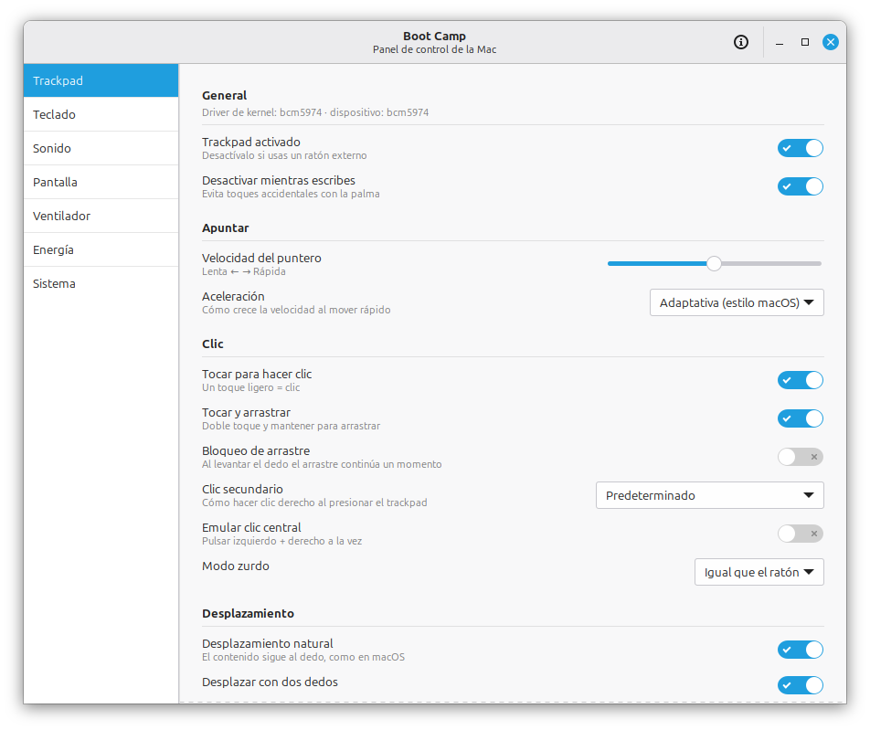
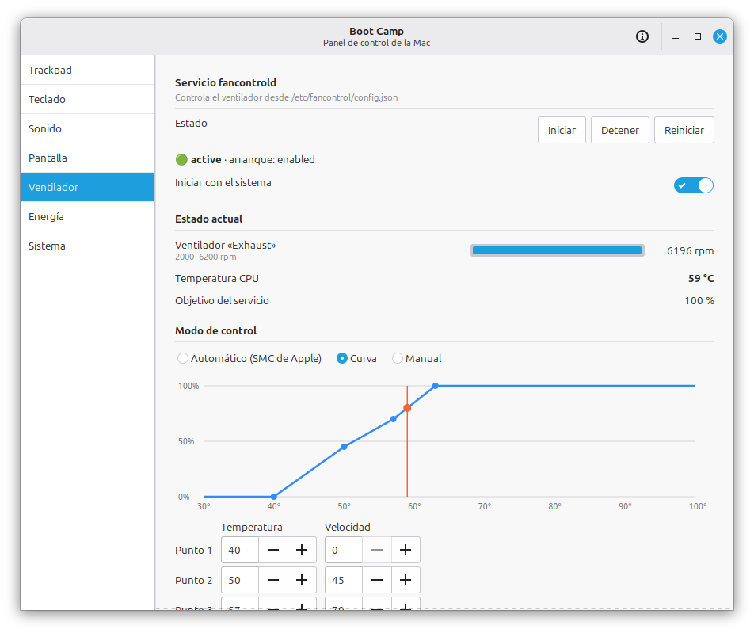
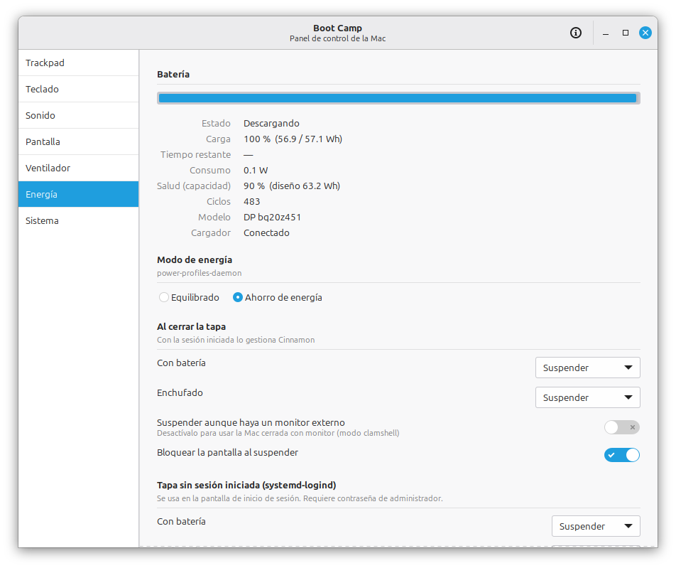
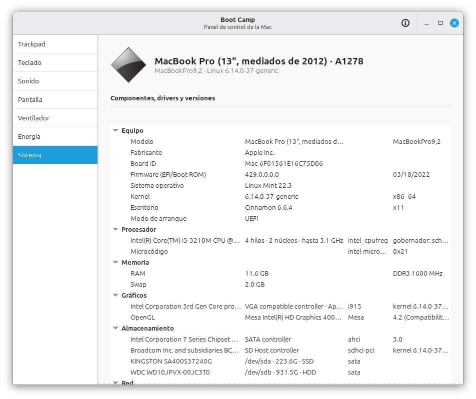
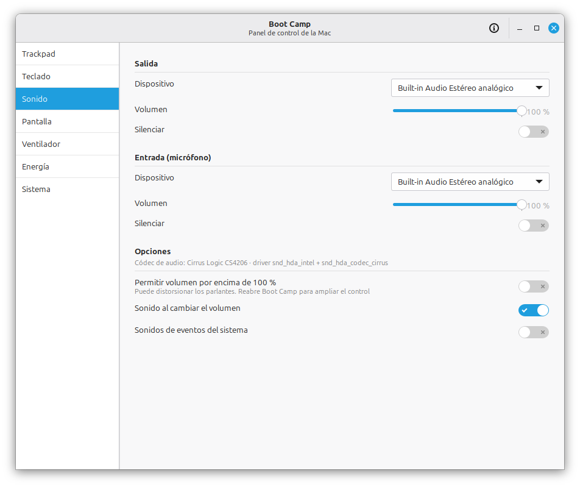
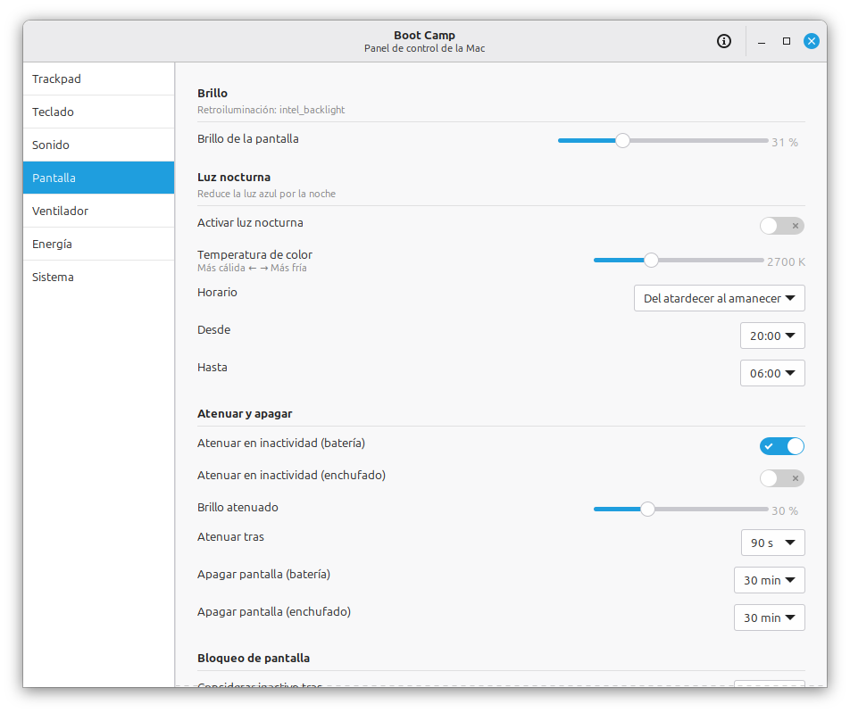

<p align="center">
  
</p>

<h1 align="center">Boot Camp para Linux</h1>

<p align="center">
  <b>El panel de control Boot Camp que tu MacBook merece, en Linux.</b><br>
  Trackpad · Teclado · Sonido · Pantalla · Ventilador · Energía · Drivers
</p>

<p align="center">
  <a href="README.md">English</a> ·
  <b>Español</b> ·
  <a href="README.ru.md">Русский</a> ·
  <a href="README.zh-CN.md">简体中文</a> ·
  <a href="README.ja.md">日本語</a>
</p>

---

En Windows, el panel **Boot Camp** de Apple permite ajustar el trackpad, las teclas de función y el
resto del hardware propio de la Mac. En Linux esos ajustes existen, pero están repartidos entre
módulos del kernel, `xinput`, `gsettings`, `systemd` y `/sys`. **Boot Camp para Linux** los reúne en
una sola ventana sencilla, para que **nunca tengas que abrir una terminal** para configurar tu Mac.

Desarrollado y probado en una **MacBook Pro 13" mediados de 2012 (A1278, MacBookPro9,2)** con
**Linux Mint 22 Cinnamon**.

## Capturas

| Trackpad | Ventilador |
|---|---|
|  |  |
| **Energía y tapa** | **Sistema y drivers** |
|  |  |
| **Sonido** | **Pantalla** |
|  |  |

## Funciones

| Pestaña | Qué puedes controlar | Por debajo |
|---|---|---|
| **Trackpad** | Activar/desactivar, desactivar al escribir, velocidad, aceleración (adaptativa/plana), tocar para clic, tocar y arrastrar, bloqueo de arrastre, clic secundario (dos dedos / esquina), clic central, modo zurdo, desplazamiento natural, con dos dedos o por el borde, velocidad de desplazamiento | Driver `bcm5974`, libinput (`xinput`), `gsettings` de Cinnamon |
| **Teclado** | Luz del teclado, **F1–F12 o teclas multimedia** (como en Boot Camp), intercambiar Option ⇄ Command, intercambiar Fn ⇄ Ctrl izquierdo | LED de `applesmc`, opciones del módulo `hid_apple` (al instante y persistentes) |
| **Sonido** | Dispositivo de salida/entrada, volumen, silencio, amplificación, sonidos del sistema | PipeWire / PulseAudio (`pactl`) |
| **Pantalla** | Brillo, luz nocturna (temperatura y horario), atenuar en inactividad, apagado de pantalla, bloqueo | `intel_backlight` vía cinnamon-settings-daemon |
| **Ventilador** | RPM y temperaturas en vivo, modos **Automático (SMC de Apple) / Curva / Manual**, curva editable con gráfico en vivo, temperaturas de aviso y emergencia, iniciar/detener el servicio | Servicio `fancontrold` + `applesmc` (incluido) |
| **Energía** | Estado de la batería, salud y ciclos, perfil de energía, **qué hacer al cerrar la tapa** (con batería / enchufado / con monitor externo), tapa en la pantalla de inicio de sesión, botón de encendido, suspensión, batería baja | UPower, power-profiles-daemon, energía de Cinnamon, `systemd-logind` |
| **Sistema** | Inventario completo de **cada componente de la Mac con su driver y versión**: modelo, firmware EFI, CPU, RAM, GPU, discos, Wi-Fi, Bluetooth, códec de audio, sensores del SMC, batería, cámara, USB y módulos del kernel propios de la Mac. Copiar o guardar el informe. | `lspci`, `lsusb`, `modinfo`, `dkms`, `/sys` |

### Servicio de control del ventilador

**fancontrold** corre como root y maneja el ventilador a través del SMC de Apple según
`/etc/fancontrol/config.json`. Sube enseguida y baja de a poco, fuerza el 100 % al pasar la
temperatura de emergencia en cualquier modo y devuelve el control al SMC al detenerse. Un pequeño
acompañante (`fanalert`) muestra una notificación cuando la CPU se calienta demasiado.

## Instalación

### En una línea

```bash
curl -fsSL https://raw.githubusercontent.com/fersbrando/Macbook-Pro-2012---Linux-Mint---Bootcamp-A1278-/main/install.sh | bash
```

### Desde un clon

```bash
git clone https://github.com/fersbrando/Macbook-Pro-2012---Linux-Mint---Bootcamp-A1278-.git bootcamp
cd bootcamp
./install.sh            # agrega --no-fan para no instalar el servicio del ventilador
```

Después abre **Boot Camp** desde el menú (Preferencias / Sistema) o ejecuta `bootcamp`.

### Qué instala

| Ruta | Contenido |
|---|---|
| `/opt/bootcamp/` | La aplicación |
| `/usr/local/bin/bootcamp` | Comando para abrirla |
| `/usr/share/applications/bootcamp.desktop` | Entrada del menú |
| `/usr/share/icons/hicolor/*/apps/bootcamp.png` | Ícono |
| `/usr/share/polkit-1/actions/io.github.fersbrando.bootcamp.policy` | Ventana de contraseña para cambios con privilegios |
| `/usr/local/lib/fancontrol/`, `/etc/fancontrol/config.json`, `fancontrold.service` | Servicio del ventilador (nunca pisa una configuración existente) |

Las dependencias que falten se instalan con `apt`: `python3-gi`, `gir1.2-gtk-3.0`, `xinput`,
`pulseaudio-utils`, `pkexec`, `upower`, `mesa-utils`, `pciutils`, `usbutils`.

### Permisos

La app corre con tu usuario normal. Solo tres tipos de cambios necesitan permisos de administrador,
y para ellos aparece la ventana gráfica de contraseña estándar (polkit), nunca la terminal:

* opciones del teclado (`/etc/modprobe.d/bootcamp-hid_apple.conf` + actualizar el initramfs),
* comportamiento de la tapa en la pantalla de inicio de sesión (`/etc/systemd/logind.conf.d/bootcamp.conf`),
* iniciar, detener, activar o desactivar el servicio del ventilador.

El helper con privilegios (`bc_helper.py`) solo acepta una lista cerrada de acciones y valida cada valor.

## Desinstalar

```bash
/opt/bootcamp-uninstall.sh          # quita la app
/opt/bootcamp-uninstall.sh --all    # también el servicio del ventilador y los ajustes de teclado/tapa
```

## Compatibilidad

| | |
|---|---|
| **Probado** | MacBook Pro 9,2 (13" mediados de 2012, A1278) · Linux Mint 22.3 Cinnamon · X11 · kernel 6.14 |
| **Debería funcionar** | MacBook Pro / Air / MacBook Intel 2008–2015 con trackpad `bcm5974` y `applesmc` |
| **Escritorio** | Ideal en Cinnamon. Trackpad, ventilador, teclado, sonido y sistema también funcionan en otros escritorios X11; pantalla y energía usan los ajustes de Cinnamon |
| **Wayland** | Todavía no: las opciones extra del trackpad usan `xinput` |

## Solución de problemas

* **El ventilador siempre está al máximo:** en la pestaña *Ventilador* elige *Curva* o *Automático*.
  *Manual 100 %* lo deja a fondo.
* **Los cambios del teclado no se mantienen al reiniciar:** vuelve a pulsar *Aplicar cambios del
  teclado*; regenera el initramfs (tarda alrededor de un minuto).
* **La pestaña *Sistema* dice "FaceTime HD: no detectada":** en este modelo la cámara es USB; si no
  aparece en `lsusb`, suele ser un cable interno flojo.
* **Hibernar no hace nada:** Linux Mint no activa la hibernación por defecto (necesita una partición
  o archivo swap tan grande como la RAM).

## Estructura

```
bootcamp.py          ventana principal (barra lateral + pestañas), --apply, --page <pestaña>
bc_helper.py         helper con privilegios (pkexec), solo lista blanca
bc/                  un módulo por pestaña + interfaz y utilidades compartidas
fancontrol/          servicio fancontrold, librería del ventilador y alertas
packaging/           entrada .desktop y política polkit
install.sh           instalador (también funciona con curl | bash)
uninstall.sh         desinstalador
```

## Licencia

MIT. Sin relación con Apple Inc. ni respaldado por ella. “Boot Camp” es una marca de Apple Inc.; aquí
solo se usa para describir de qué es equivalente esta herramienta en Linux.
