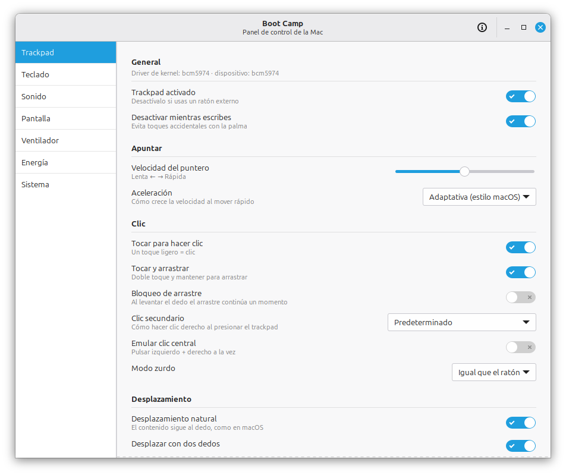
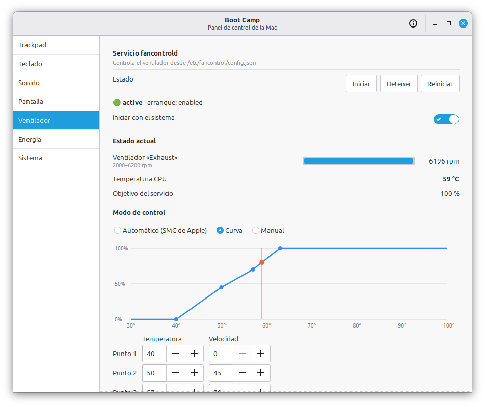
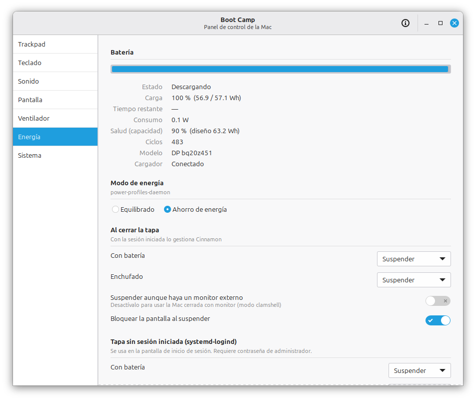
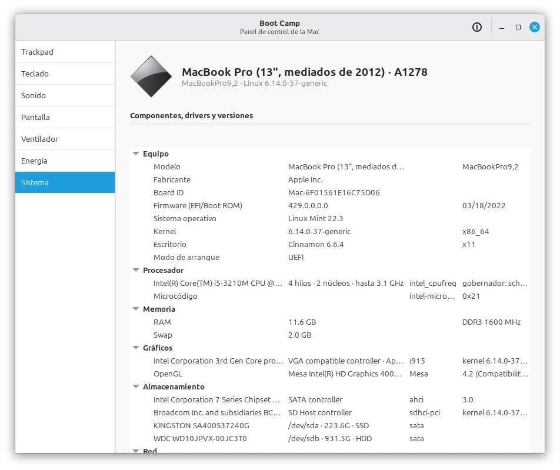
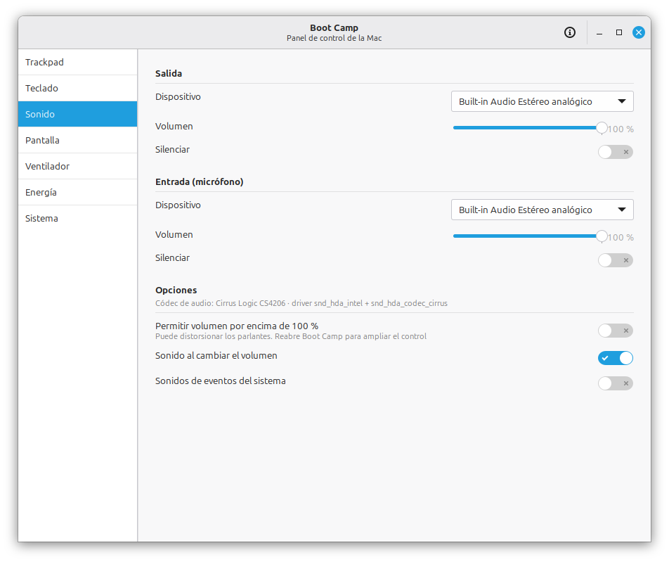
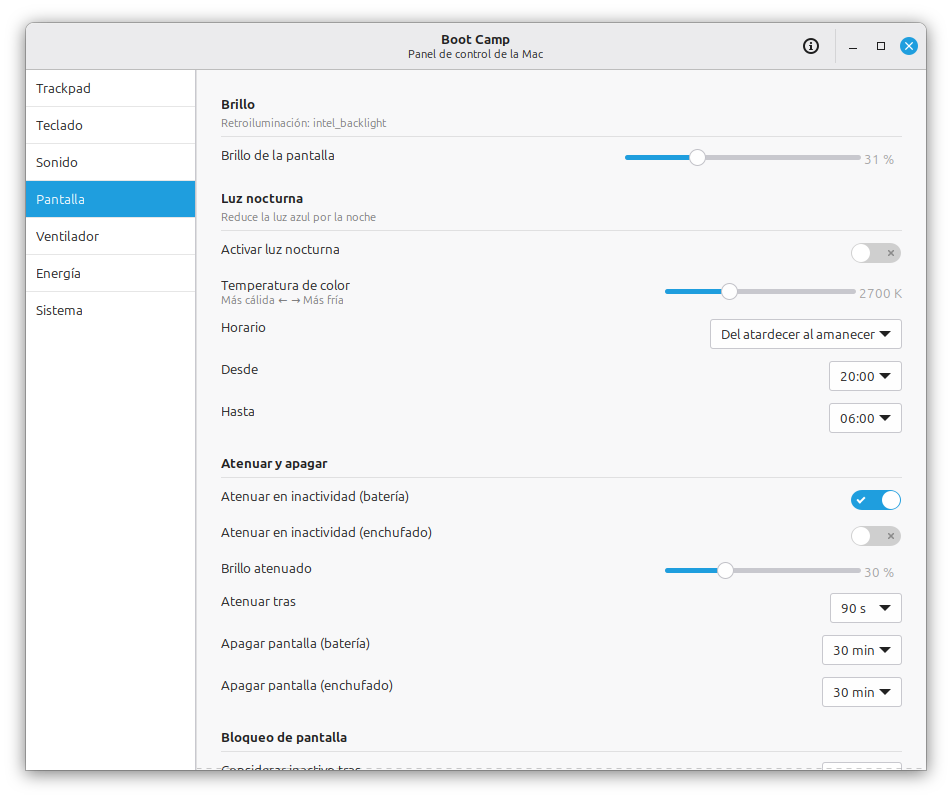

<p align="center">
  
</p>

<h1 align="center">Boot Camp for Linux</h1>

<p align="center">
  <b>MacBook のための Boot Camp コントロールパネルを Linux で。</b><br>
  トラックパッド · キーボード · サウンド · ディスプレイ · ファン · 電源 · ドライバ
</p>

<p align="center">
  <a href="README.md">English</a> ·
  <a href="README.es.md">Español</a> ·
  <a href="README.ru.md">Русский</a> ·
  <a href="README.zh-CN.md">简体中文</a> ·
  <b>日本語</b>
</p>

---

Windows では Apple の **Boot Camp** コントロールパネルで、トラックパッドやファンクションキーなど Mac 固有の
ハードウェアを設定できます。Linux にも同じ設定はありますが、カーネルモジュール、`xinput`、`gsettings`、
`systemd`、`/sys` に散らばっています。**Boot Camp for Linux** はそれらをひとつのシンプルなウィンドウにまとめ、
**ターミナルを開かずに** Mac を設定できるようにします。

開発・テスト環境：**MacBook Pro 13インチ Mid 2012（A1278、MacBookPro9,2）**、**Linux Mint 22 Cinnamon**。

## スクリーンショット

| トラックパッド | ファン |
|---|---|
|  |  |
| **電源とフタ** | **システムとドライバ** |
|  |  |
| **サウンド** | **ディスプレイ** |
|  |  |

> 現在、アプリの表示言語はスペイン語です。

## 機能

| タブ | 設定できる項目 | 仕組み |
|---|---|---|
| **トラックパッド** | オン/オフ、入力中は無効、ポインタの速さ、加速（アダプティブ/フラット）、タップでクリック、タップでドラッグ、ドラッグロック、副ボタンのクリック（2本指/右下隅）、中ボタンのエミュレーション、左利き、ナチュラルスクロール、2本指/端でのスクロール、スクロール速度 | `bcm5974` ドライバ、libinput（`xinput`）、Cinnamon の `gsettings` |
| **キーボード** | キーボードバックライト、**F1–F12 とメディアキーの優先切り替え**（Boot Camp と同じ）、Option ⇄ Command の入れ替え、Fn ⇄ 左 Ctrl の入れ替え | `applesmc` の LED、`hid_apple` モジュールオプション（即時反映・永続化） |
| **サウンド** | 出力/入力デバイス、音量、ミュート、100% を超える増幅、システムサウンド | PipeWire / PulseAudio（`pactl`） |
| **ディスプレイ** | 明るさ、夜間モード（色温度とスケジュール）、アイドル時の減光、画面オフ、画面ロック | cinnamon-settings-daemon 経由の `intel_backlight` |
| **ファン** | 回転数と温度のリアルタイム表示、**自動（Apple SMC）/ カーブ / 手動** モード、グラフ付きの編集可能なファンカーブ、警告・緊急温度、サービスの開始/停止 | `fancontrold` サービス + `applesmc`（同梱） |
| **電源** | バッテリーの状態・劣化度・充放電回数、電源プロファイル、**フタを閉じたときの動作**（バッテリー / 電源接続 / 外部モニタ接続時）、ログイン画面でのフタの動作、電源ボタン、スリープまでの時間、バッテリー残量低下時の動作 | UPower、power-profiles-daemon、Cinnamon の電源設定、`systemd-logind` |
| **システム** | **Mac のすべての部品とそのドライバ・バージョン**の一覧：モデル、EFI ファームウェア、CPU、メモリ、GPU、ストレージ、Wi-Fi、Bluetooth、オーディオコーデック、SMC センサー、バッテリー、カメラ、USB デバイス、Mac 用カーネルモジュール。レポートのコピー・保存も可能。 | `lspci`、`lsusb`、`modinfo`、`dkms`、`/sys` |

### ファン制御サービス

**fancontrold** は root で動作し、`/etc/fancontrol/config.json` に従って Apple SMC 経由でファンを制御します。
すぐに回転を上げ、ゆっくり下げます。どのモードでも緊急温度を超えると 100% に固定し、停止時には制御を SMC に戻します。
補助ツール `fanalert` は CPU が熱くなりすぎるとデスクトップ通知を表示します。

## インストール

### 1行で

```bash
curl -fsSL https://raw.githubusercontent.com/fersbrando/Macbook-Pro-2012---Linux-Mint---Bootcamp-A1278-/main/install.sh | bash
```

### リポジトリから

```bash
git clone https://github.com/fersbrando/Macbook-Pro-2012---Linux-Mint---Bootcamp-A1278-.git bootcamp
cd bootcamp
./install.sh            # ファンサービスが不要なら --no-fan
```

その後、アプリケーションメニュー（設定 / システム）から **Boot Camp** を開くか、`bootcamp` を実行します。

### インストールされるもの

| パス | 内容 |
|---|---|
| `/opt/bootcamp/` | アプリ本体 |
| `/usr/local/bin/bootcamp` | 起動コマンド |
| `/usr/share/applications/bootcamp.desktop` | メニュー項目 |
| `/usr/share/icons/hicolor/*/apps/bootcamp.png` | アイコン |
| `/usr/share/polkit-1/actions/io.github.fersbrando.bootcamp.policy` | 管理者権限が必要な変更のパスワード画面 |
| `/usr/local/lib/fancontrol/`、`/etc/fancontrol/config.json`、`fancontrold.service` | ファンサービス（既存の設定は上書きしません） |

不足している依存パッケージは `apt` でインストールされます：`python3-gi`、`gir1.2-gtk-3.0`、`xinput`、
`pulseaudio-utils`、`pkexec`、`upower`、`mesa-utils`、`pciutils`、`usbutils`。

### 権限について

アプリは通常ユーザーで動作します。管理者権限が必要なのは次の3種類の変更だけで、その際は標準のグラフィカルな
パスワード画面（polkit）が表示されます。ターミナルは不要です：

* キーボードのオプション（`/etc/modprobe.d/bootcamp-hid_apple.conf` と initramfs の更新）
* ログイン画面でのフタの動作（`/etc/systemd/logind.conf.d/bootcamp.conf`）
* ファンサービスの開始・停止・有効化・無効化

特権ヘルパー（`bc_helper.py`）は決められた操作だけを受け付け、すべての値を検証します。

## アンインストール

```bash
/opt/bootcamp-uninstall.sh          # アプリを削除
/opt/bootcamp-uninstall.sh --all    # ファンサービスとキーボード/フタの設定も削除
```

## 対応環境

| | |
|---|---|
| **テスト済み** | MacBook Pro 9,2（13インチ Mid 2012、A1278）· Linux Mint 22.3 Cinnamon · X11 · カーネル 6.14 |
| **動作するはず** | `bcm5974` トラックパッドと `applesmc` を搭載した 2008–2015 年の Intel MacBook Pro / Air / MacBook |
| **デスクトップ** | Cinnamon が最適。トラックパッド・ファン・キーボード・サウンド・システムは他の X11 デスクトップでも動作。ディスプレイと電源は Cinnamon の設定を使用 |
| **Wayland** | 未対応：トラックパッドの追加設定は `xinput` を使用 |

## トラブルシューティング

* **ファンが常に最大回転：** *Ventilador*（ファン）タブで *Curva*（カーブ）か *Automático*（自動）を選びます。*Manual 100 %* では最大のままです。
* **再起動するとキーボード設定が戻る：** もう一度 *Aplicar cambios del teclado* を押してください。initramfs を再生成します（約1分）。
* ***Sistema* タブに「FaceTime HD: 検出されません」と表示される：** このモデルのカメラは USB 接続です。`lsusb` に表示されない場合、内部ケーブルの緩みが多い原因です。
* **ハイバネートしない：** Linux Mint は標準でハイバネートを有効にしていません（メモリと同じサイズのスワップが必要です）。

## ライセンス

MIT。本プロジェクトは Apple Inc. とは無関係であり、承認も受けていません。「Boot Camp」は Apple Inc. の商標で、
ここでは本ツールが Linux における何に相当するかを説明するためにのみ使用しています。
