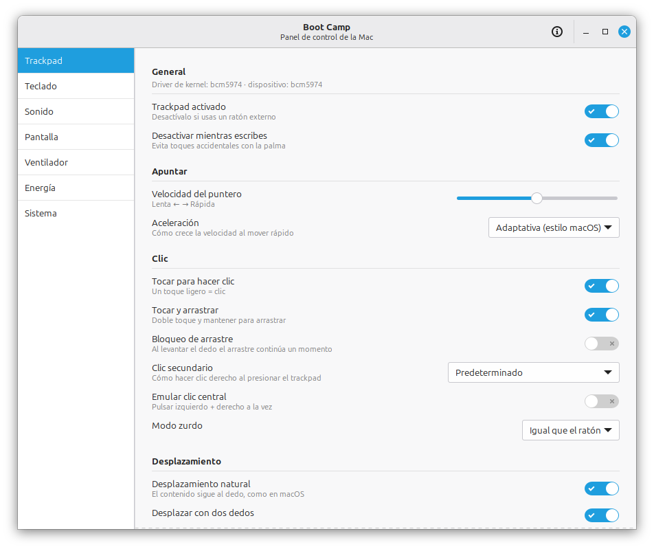
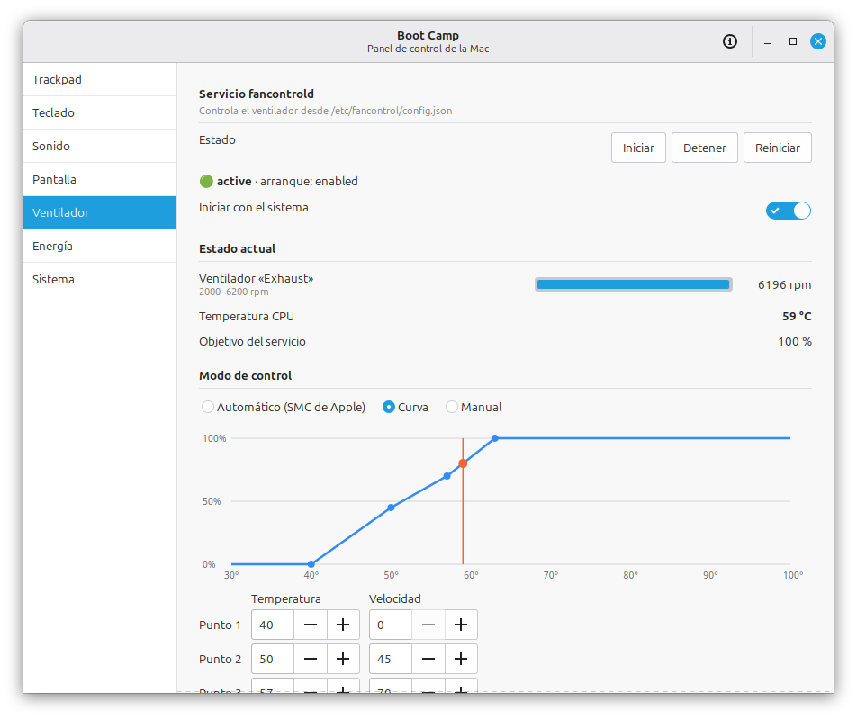
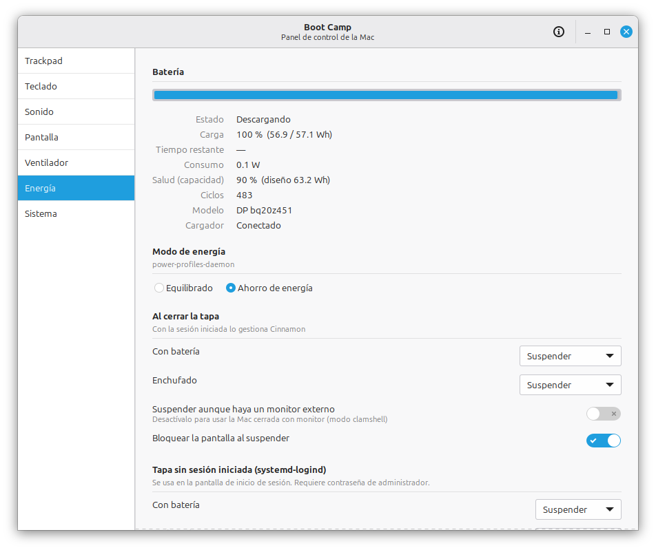
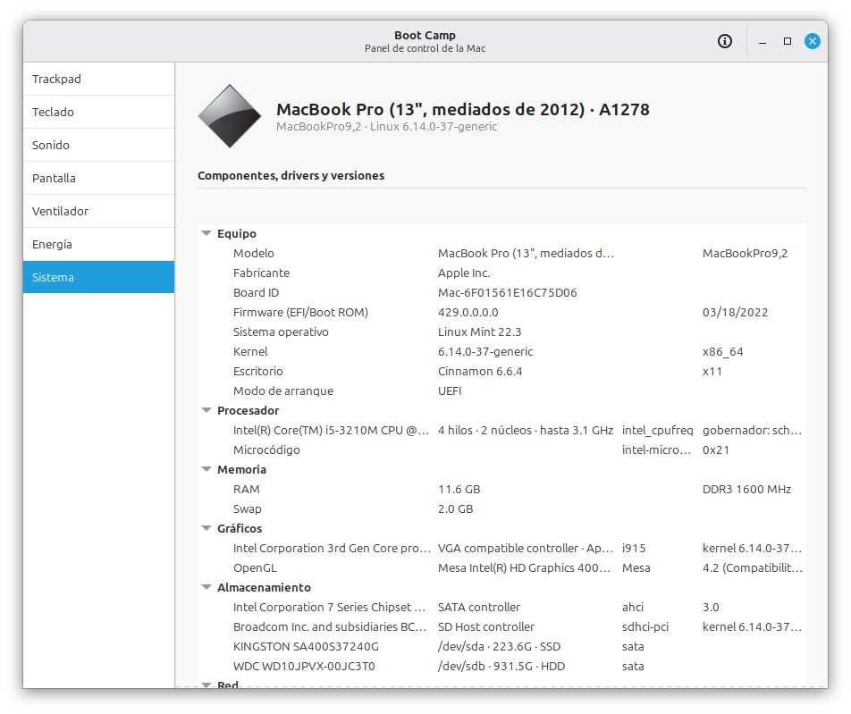
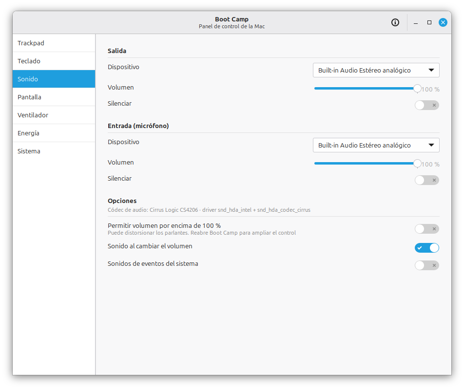
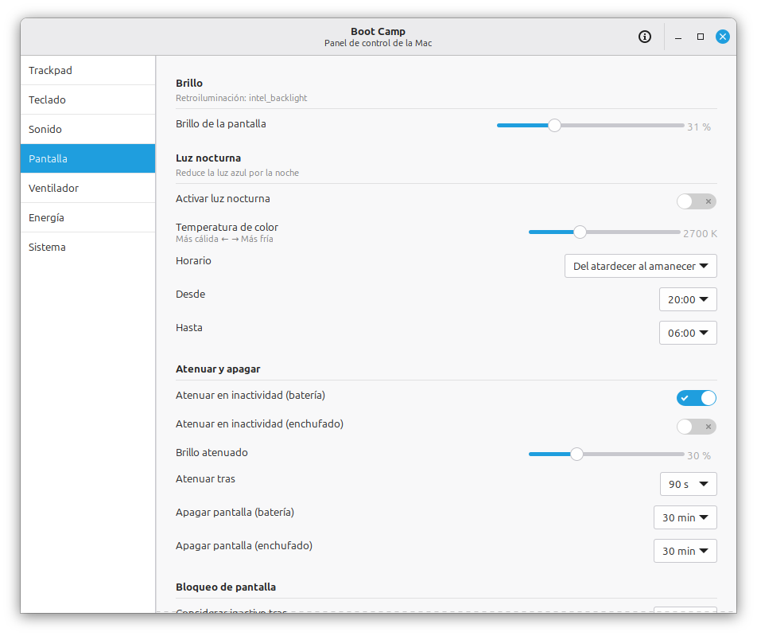

<p align="center">
  
</p>

<h1 align="center">Boot Camp for Linux</h1>

<p align="center">
  <b>The Boot Camp control panel your MacBook deserves — on Linux.</b><br>
  Trackpad · Keyboard · Sound · Display · Fan · Power · Drivers
</p>

<p align="center">
  <b>English</b> ·
  <a href="README.es.md">Español</a> ·
  <a href="README.ru.md">Русский</a> ·
  <a href="README.zh-CN.md">简体中文</a> ·
  <a href="README.ja.md">日本語</a>
</p>

---

On Windows, Apple's **Boot Camp** control panel lets you tune the trackpad, function keys and other
Mac-specific hardware. On Linux those settings exist, but they are scattered across kernel modules,
`xinput`, `gsettings`, `systemd` and `/sys`. **Boot Camp for Linux** puts all of them in one simple
window so you **never need to open a terminal** to configure your Mac.

Built and tested on a **MacBook Pro 13" Mid 2012 (A1278, MacBookPro9,2)** with **Linux Mint 22 Cinnamon**.

## Screenshots

| Trackpad | Fan |
|---|---|
|  |  |
| **Power & lid** | **System & drivers** |
|  |  |
| **Sound** | **Display** |
|  |  |

> The interface is currently in Spanish. Tab names: *Trackpad*, *Teclado* (keyboard), *Sonido* (sound),
> *Pantalla* (display), *Ventilador* (fan), *Energía* (power), *Sistema* (system).

## Features

| Tab | What you can control | Under the hood |
|---|---|---|
| **Trackpad** | On/off, disable while typing, pointer speed, acceleration (adaptive/flat), tap to click, tap and drag, drag lock, secondary click (two fingers / corner), middle-click emulation, left-handed, natural scrolling, two-finger/edge scrolling, scroll speed | `bcm5974` driver, libinput (`xinput`), Cinnamon `gsettings` |
| **Keyboard** | Keyboard backlight, **F1–F12 vs media keys** (like Boot Camp), swap Option ⇄ Command, swap Fn ⇄ Left Ctrl | `applesmc` LED, `hid_apple` module options (applied live and persisted) |
| **Sound** | Output/input device, volume, mute, over-amplification, system sounds | PipeWire / PulseAudio (`pactl`) |
| **Display** | Brightness, Night Light (temperature and schedule), dim when idle, screen-off timers, screen lock | `intel_backlight` via cinnamon-settings-daemon |
| **Fan** | Live RPM and temperatures, **Auto (Apple SMC) / Curve / Manual** modes, editable fan curve with a live graph, alert and emergency temperatures, start/stop the service | `fancontrold` service + `applesmc` (included) |
| **Power** | Battery status, health and cycle count, power profile, **what to do when the lid closes** (on battery / plugged in / with an external monitor), lid behaviour on the login screen, power button, sleep timers, low-battery actions | UPower, power-profiles-daemon, Cinnamon power settings, `systemd-logind` |
| **System** | Full inventory of **every component of the Mac with its driver and version**: model, EFI firmware, CPU, RAM, GPU, storage, Wi-Fi, Bluetooth, audio codec, SMC sensors, battery, camera, USB devices and Mac-specific kernel modules. Copy or save the report. | `lspci`, `lsusb`, `modinfo`, `dkms`, `/sys` |

### Fan control service

The **fancontrold** service runs as root and drives the fan through the Apple SMC according to
`/etc/fancontrol/config.json`. It ramps up immediately and slows down gradually, forces 100 % above
the emergency temperature in every mode, and hands control back to the SMC when it stops. A small
companion (`fanalert`) shows a desktop notification when the CPU gets too hot.

## Installation

### One line

```bash
curl -fsSL https://raw.githubusercontent.com/fersbrando/Macbook-Pro-2012---Linux-Mint---Bootcamp-A1278-/main/install.sh | bash
```

### From a clone

```bash
git clone https://github.com/fersbrando/Macbook-Pro-2012---Linux-Mint---Bootcamp-A1278-.git bootcamp
cd bootcamp
./install.sh            # add --no-fan to skip the fan service
```

Then open **Boot Camp** from the application menu (Preferences / System), or run `bootcamp`.

### What the installer does

| Path | Content |
|---|---|
| `/opt/bootcamp/` | The application |
| `/usr/local/bin/bootcamp` | Launcher command |
| `/usr/share/applications/bootcamp.desktop` | Menu entry |
| `/usr/share/icons/hicolor/*/apps/bootcamp.png` | Icon |
| `/usr/share/polkit-1/actions/io.github.fersbrando.bootcamp.policy` | Password prompt for privileged changes |
| `/usr/local/lib/fancontrol/`, `/etc/fancontrol/config.json`, `fancontrold.service` | Fan service (an existing config is never overwritten) |

Missing dependencies are installed with `apt`: `python3-gi`, `gir1.2-gtk-3.0`, `xinput`,
`pulseaudio-utils`, `pkexec`, `upower`, `mesa-utils`, `pciutils`, `usbutils`.

### Privileges

The app runs as your normal user. Only three kinds of changes need administrator rights, and for
those it shows the standard graphical password dialog (polkit). It never asks you to use a terminal:

* keyboard options (`/etc/modprobe.d/bootcamp-hid_apple.conf` + initramfs update),
* lid behaviour on the login screen (`/etc/systemd/logind.conf.d/bootcamp.conf`),
* starting, stopping, enabling or disabling the fan service.

The privileged helper (`bc_helper.py`) only accepts a fixed list of actions and validates every value.

## Uninstall

```bash
/opt/bootcamp-uninstall.sh          # removes the app
/opt/bootcamp-uninstall.sh --all    # also removes the fan service and keyboard/lid tweaks
```

## Compatibility

| | |
|---|---|
| **Tested** | MacBook Pro 9,2 (13" Mid 2012, A1278) · Linux Mint 22.3 Cinnamon · X11 · kernel 6.14 |
| **Should work** | Intel MacBook Pro / Air / MacBook 2008–2015 with the `bcm5974` trackpad and `applesmc` |
| **Desktop** | Best on Cinnamon. Trackpad, fan, keyboard, sound and system tabs also work on other X11 desktops; display/power options use Cinnamon settings |
| **Wayland** | Not yet: the extra trackpad options use `xinput` |

## Troubleshooting

* **The fan is always at maximum:** open the *Fan* tab and choose *Curve* or *Auto*. *Manual 100 %*
  keeps it at full speed.
* **Keyboard changes don't stick after a reboot:** use *Apply keyboard changes* again; it regenerates
  the initramfs (takes about a minute).
* **The *Sistema* tab says "FaceTime HD: not detected":** on this model the camera is a USB device;
  if it doesn't show up in `lsusb` it is usually a loose internal cable.
* **Hibernate does nothing:** Linux Mint does not enable hibernation by default (it needs a swap
  partition/file as large as your RAM).

## Project layout

```
bootcamp.py          main window (sidebar + tabs), --apply, --page <tab>
bc_helper.py         privileged helper (pkexec), whitelist only
bc/                  one module per tab + shared UI and utilities
fancontrol/          fancontrold service, fan library and desktop alerts
packaging/           .desktop entry and polkit policy
install.sh           installer (also works through curl | bash)
uninstall.sh         uninstaller
```

## License

MIT. Not affiliated with or endorsed by Apple Inc. “Boot Camp” is a trademark of Apple Inc.; it is
used here only to describe what this tool is the Linux equivalent of.
