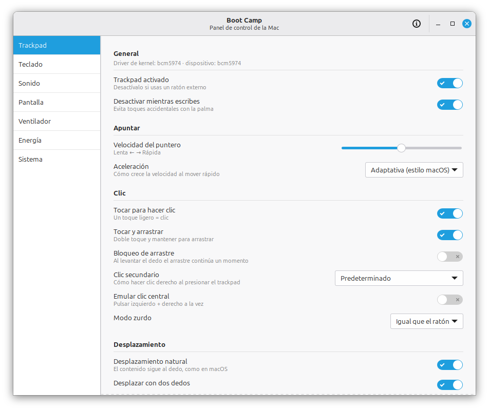
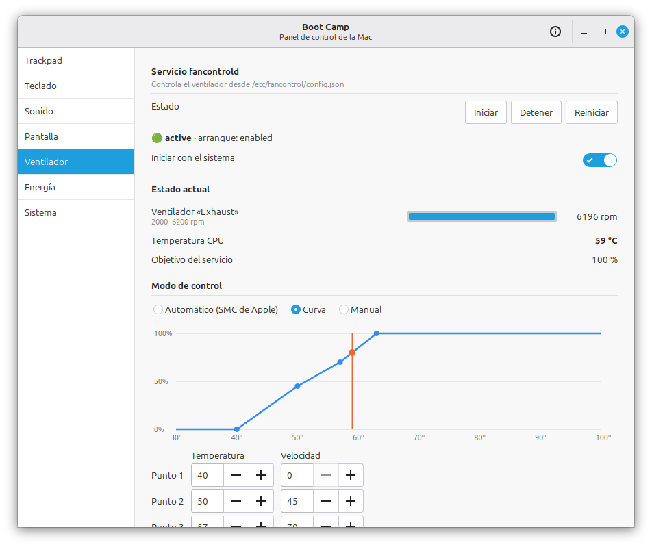
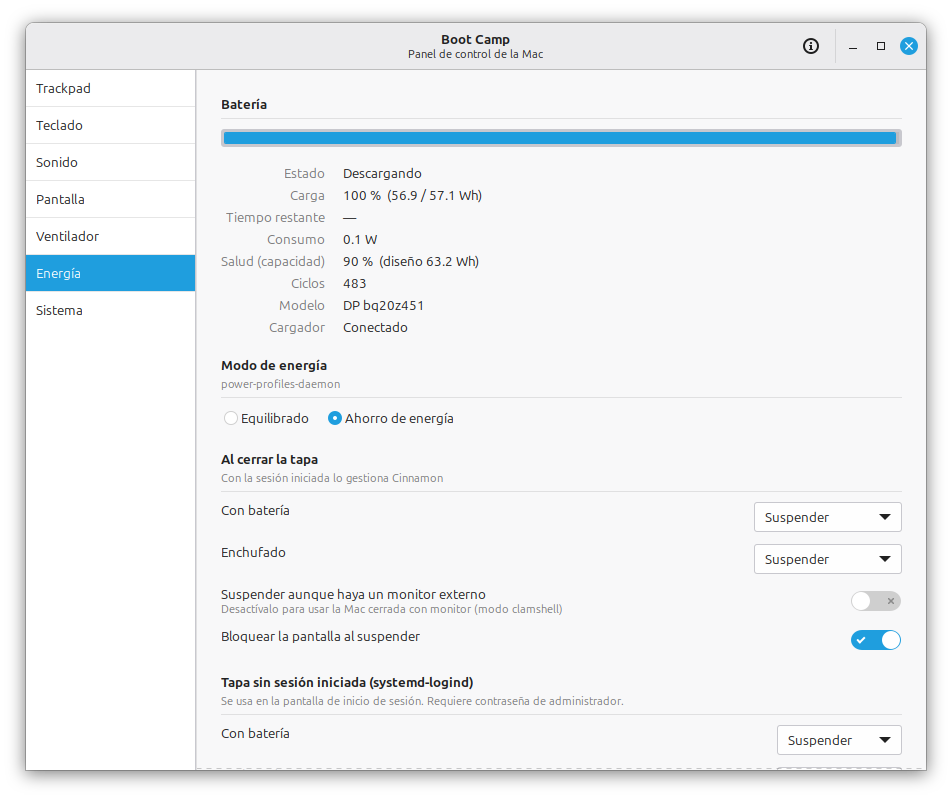
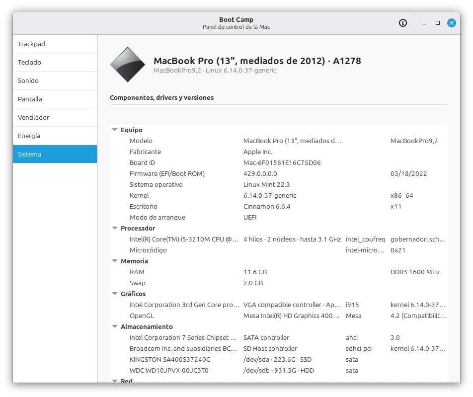
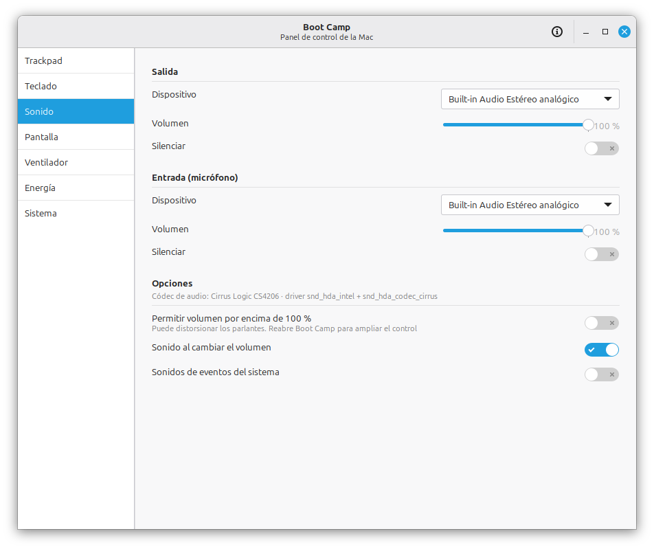
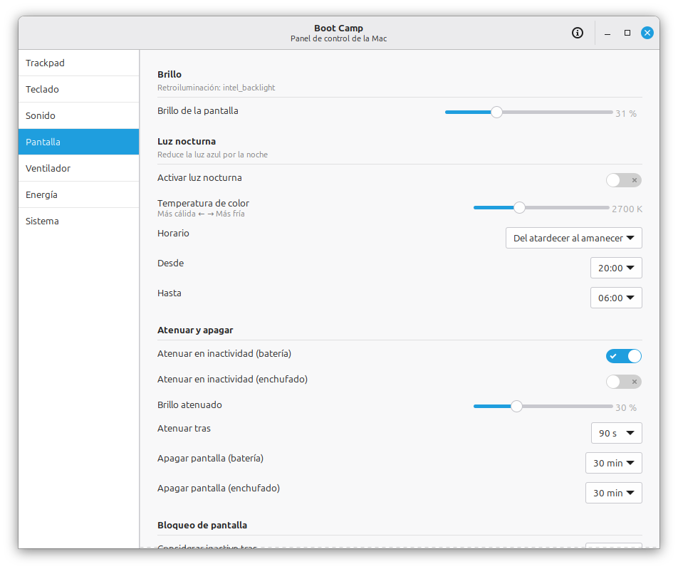

<p align="center">
  
</p>

<h1 align="center">Boot Camp для Linux</h1>

<p align="center">
  <b>Панель управления Boot Camp для вашего MacBook — теперь в Linux.</b><br>
  Трекпад · Клавиатура · Звук · Экран · Вентилятор · Питание · Драйверы
</p>

<p align="center">
  <a href="README.md">English</a> ·
  <a href="README.es.md">Español</a> ·
  <b>Русский</b> ·
  <a href="README.zh-CN.md">简体中文</a> ·
  <a href="README.ja.md">日本語</a>
</p>

---

В Windows панель Apple **Boot Camp** позволяет настраивать трекпад, функциональные клавиши и другое
оборудование Mac. В Linux эти настройки тоже есть, но они разбросаны по модулям ядра, `xinput`,
`gsettings`, `systemd` и `/sys`. **Boot Camp для Linux** собирает их в одном простом окне, чтобы
**вам никогда не пришлось открывать терминал** для настройки Mac.

Разработано и проверено на **MacBook Pro 13" Mid 2012 (A1278, MacBookPro9,2)** с **Linux Mint 22 Cinnamon**.

## Скриншоты

| Трекпад | Вентилятор |
|---|---|
|  |  |
| **Питание и крышка** | **Система и драйверы** |
|  |  |
| **Звук** | **Экран** |
|  |  |

> Интерфейс программы пока на испанском языке.

## Возможности

| Вкладка | Что можно настроить | Как это работает |
|---|---|---|
| **Трекпад** | Вкл/выкл, отключение при наборе текста, скорость указателя, ускорение (адаптивное/плоское), касание как щелчок, перетаскивание касанием, фиксация перетаскивания, вторичный щелчок (двумя пальцами / в углу), эмуляция средней кнопки, режим для левши, естественная прокрутка, прокрутка двумя пальцами или по краю, скорость прокрутки | драйвер `bcm5974`, libinput (`xinput`), `gsettings` Cinnamon |
| **Клавиатура** | Подсветка клавиатуры, **F1–F12 или мультимедийные клавиши** (как в Boot Camp), поменять Option ⇄ Command, поменять Fn ⇄ левый Ctrl | светодиод `applesmc`, параметры модуля `hid_apple` (сразу и навсегда) |
| **Звук** | Устройство вывода/ввода, громкость, отключение звука, усиление выше 100 %, системные звуки | PipeWire / PulseAudio (`pactl`) |
| **Экран** | Яркость, ночной режим (температура и расписание), затемнение при простое, отключение экрана, блокировка | `intel_backlight` через cinnamon-settings-daemon |
| **Вентилятор** | Обороты и температуры в реальном времени, режимы **Авто (Apple SMC) / Кривая / Ручной**, редактируемая кривая с графиком, температуры предупреждения и аварии, запуск/остановка службы | служба `fancontrold` + `applesmc` (входит в комплект) |
| **Питание** | Состояние батареи, износ и число циклов, профиль питания, **действие при закрытии крышки** (от батареи / от сети / с внешним монитором), крышка на экране входа, кнопка питания, таймеры сна, низкий заряд | UPower, power-profiles-daemon, настройки питания Cinnamon, `systemd-logind` |
| **Система** | Полный список **всех компонентов Mac с драйверами и версиями**: модель, прошивка EFI, процессор, ОЗУ, видео, накопители, Wi-Fi, Bluetooth, аудиокодек, датчики SMC, батарея, камера, USB-устройства и модули ядра для Mac. Отчёт можно скопировать или сохранить. | `lspci`, `lsusb`, `modinfo`, `dkms`, `/sys` |

### Служба управления вентилятором

**fancontrold** работает от root и управляет вентилятором через Apple SMC согласно
`/etc/fancontrol/config.json`. Обороты растут сразу и снижаются плавно; выше аварийной температуры в
любом режиме включается 100 %; при остановке управление возвращается SMC. Небольшой помощник
(`fanalert`) показывает уведомление, если процессор слишком нагрелся.

## Установка

### Одной командой

```bash
curl -fsSL https://raw.githubusercontent.com/fersbrando/Macbook-Pro-2012---Linux-Mint---Bootcamp-A1278-/main/install.sh | bash
```

### Из клона репозитория

```bash
git clone https://github.com/fersbrando/Macbook-Pro-2012---Linux-Mint---Bootcamp-A1278-.git bootcamp
cd bootcamp
./install.sh            # --no-fan — без службы вентилятора
```

Затем откройте **Boot Camp** из меню приложений (Параметры / Система) или выполните `bootcamp`.

### Что устанавливается

| Путь | Содержимое |
|---|---|
| `/opt/bootcamp/` | Приложение |
| `/usr/local/bin/bootcamp` | Команда запуска |
| `/usr/share/applications/bootcamp.desktop` | Пункт меню |
| `/usr/share/icons/hicolor/*/apps/bootcamp.png` | Значок |
| `/usr/share/polkit-1/actions/io.github.fersbrando.bootcamp.policy` | Запрос пароля для привилегированных изменений |
| `/usr/local/lib/fancontrol/`, `/etc/fancontrol/config.json`, `fancontrold.service` | Служба вентилятора (существующая конфигурация не перезаписывается) |

Недостающие зависимости ставятся через `apt`: `python3-gi`, `gir1.2-gtk-3.0`, `xinput`,
`pulseaudio-utils`, `pkexec`, `upower`, `mesa-utils`, `pciutils`, `usbutils`.

### Права доступа

Приложение работает от обычного пользователя. Права администратора нужны только для трёх видов
изменений, и для них показывается стандартное графическое окно ввода пароля (polkit), а не терминал:

* параметры клавиатуры (`/etc/modprobe.d/bootcamp-hid_apple.conf` + обновление initramfs),
* поведение крышки на экране входа (`/etc/systemd/logind.conf.d/bootcamp.conf`),
* запуск, остановка, включение и отключение службы вентилятора.

Привилегированный помощник (`bc_helper.py`) принимает только фиксированный список действий и проверяет каждое значение.

## Удаление

```bash
/opt/bootcamp-uninstall.sh          # удалить приложение
/opt/bootcamp-uninstall.sh --all    # также службу вентилятора и настройки клавиатуры/крышки
```

## Совместимость

| | |
|---|---|
| **Проверено** | MacBook Pro 9,2 (13" Mid 2012, A1278) · Linux Mint 22.3 Cinnamon · X11 · ядро 6.14 |
| **Должно работать** | MacBook Pro / Air / MacBook на Intel 2008–2015 с трекпадом `bcm5974` и `applesmc` |
| **Окружение** | Лучше всего Cinnamon. Трекпад, вентилятор, клавиатура, звук и система работают и в других X11-окружениях; экран и питание используют настройки Cinnamon |
| **Wayland** | Пока нет: дополнительные настройки трекпада используют `xinput` |

## Решение проблем

* **Вентилятор всегда на максимуме:** на вкладке *Ventilador* выберите *Curva* (кривая) или
  *Automático*. Режим *Manual 100 %* держит максимальные обороты.
* **Настройки клавиатуры сбрасываются после перезагрузки:** снова нажмите *Aplicar cambios del
  teclado* — initramfs будет пересобран (около минуты).
* **На вкладке *Sistema* написано «FaceTime HD: не обнаружена»:** в этой модели камера подключена по
  USB; если её нет в `lsusb`, обычно отошёл внутренний шлейф.
* **Гибернация не работает:** в Linux Mint она по умолчанию выключена (нужен раздел или файл подкачки
  размером с ОЗУ).

## Лицензия

MIT. Проект не связан с Apple Inc. и не одобрен ею. «Boot Camp» — товарный знак Apple Inc.; здесь он
используется только для описания того, аналогом чего является эта программа в Linux.
