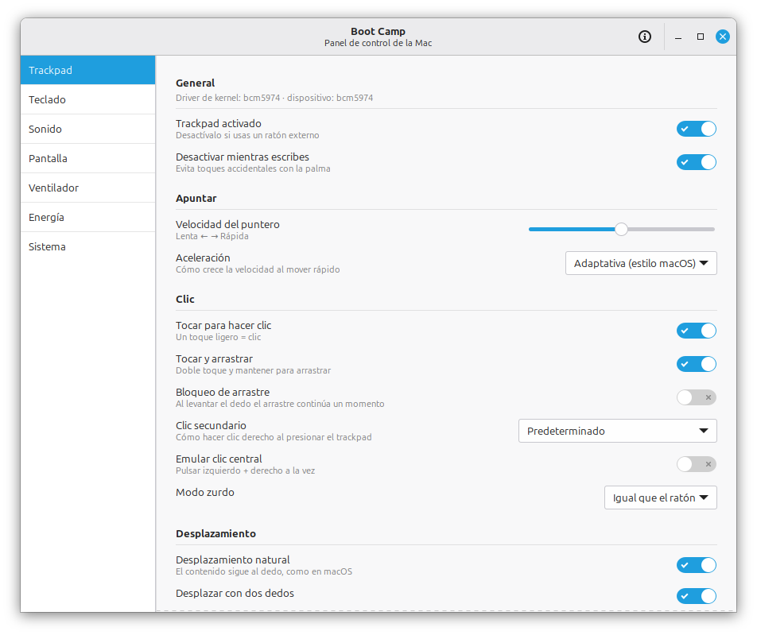
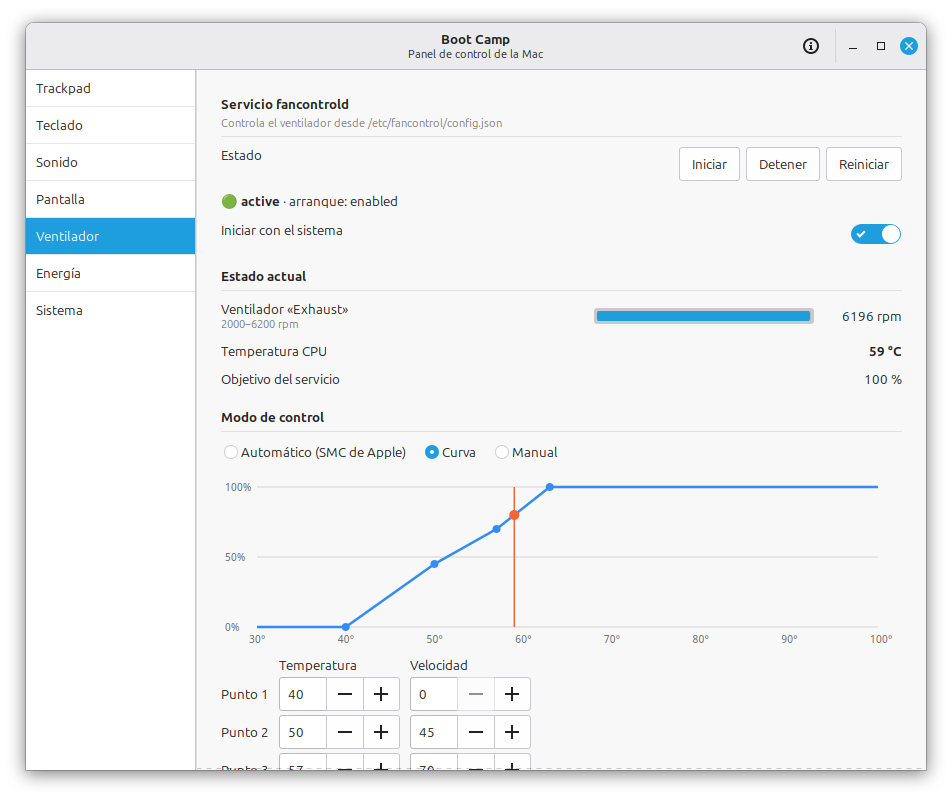
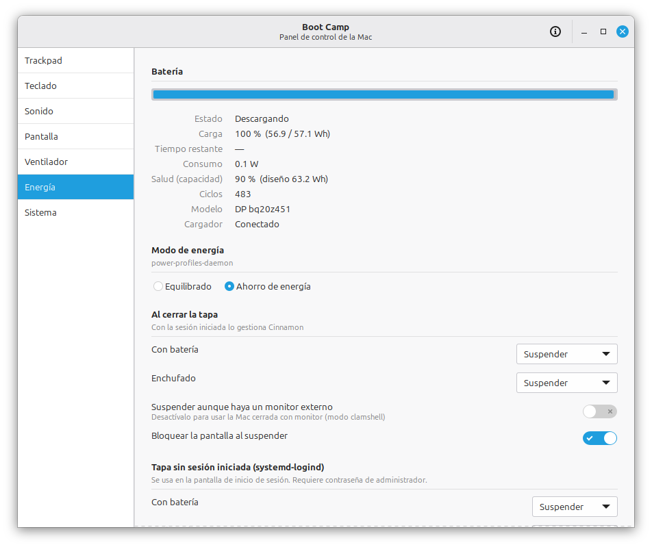
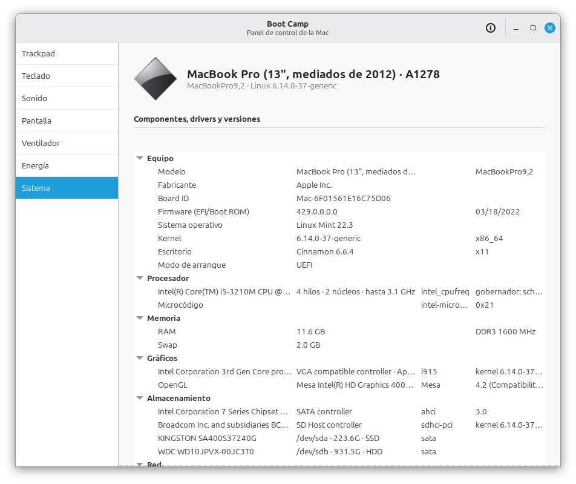
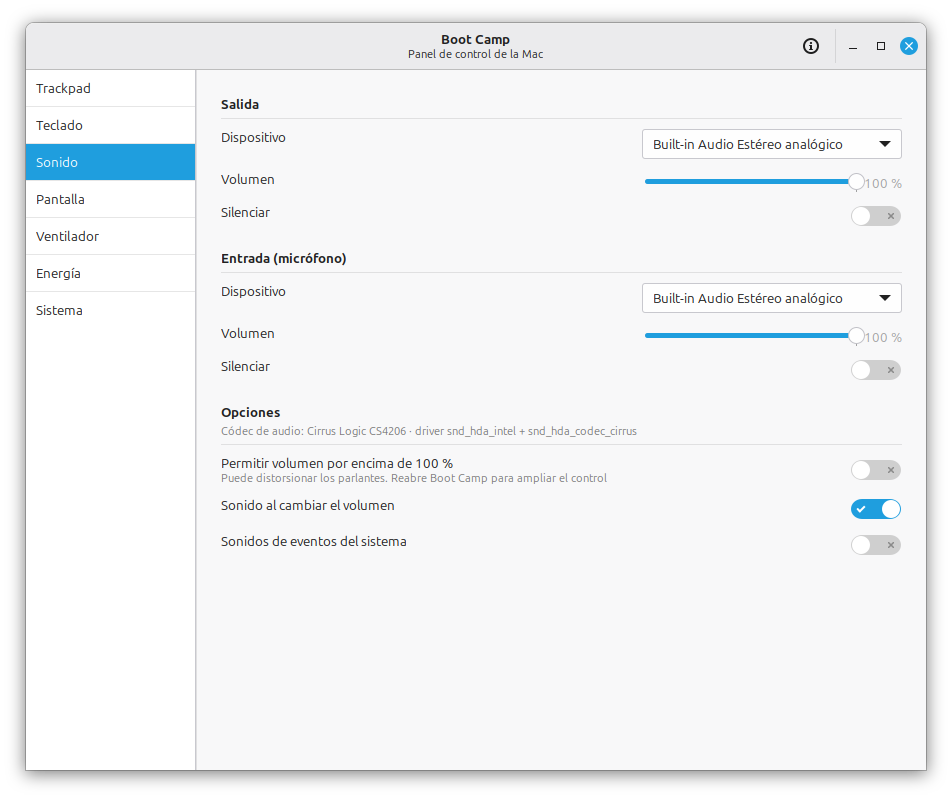
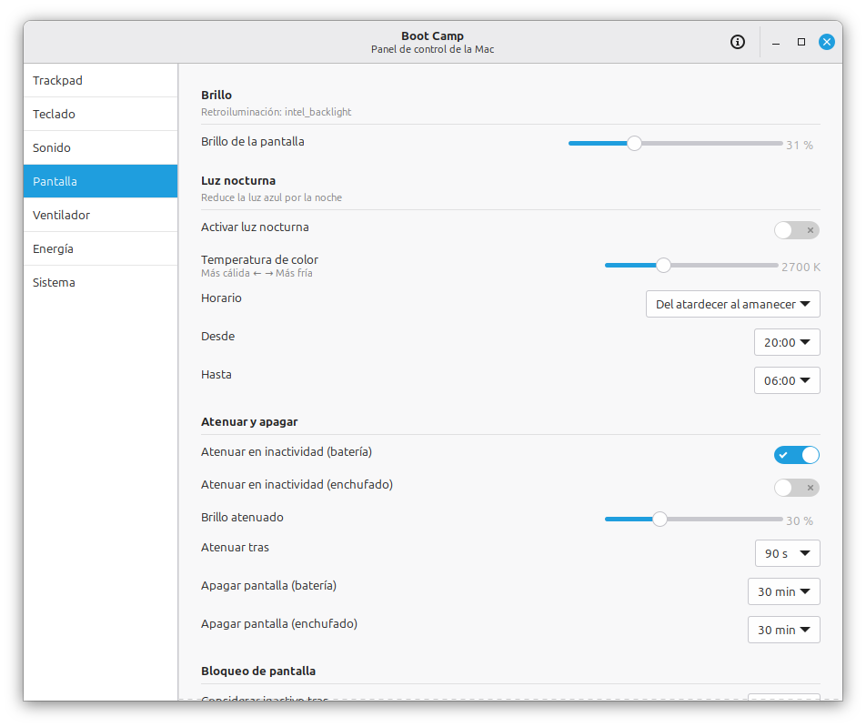

<p align="center">
  
</p>

<h1 align="center">Boot Camp for Linux</h1>

<p align="center">
  <b>在 Linux 上为你的 MacBook 带来 Boot Camp 控制面板。</b><br>
  触控板 · 键盘 · 声音 · 显示器 · 风扇 · 电源 · 驱动程序
</p>

<p align="center">
  <a href="README.md">English</a> ·
  <a href="README.es.md">Español</a> ·
  <a href="README.ru.md">Русский</a> ·
  <b>简体中文</b> ·
  <a href="README.ja.md">日本語</a>
</p>

---

在 Windows 上，Apple 的 **Boot Camp** 控制面板可以调整触控板、功能键以及其他 Mac 专属硬件。
在 Linux 上这些设置同样存在，但分散在内核模块、`xinput`、`gsettings`、`systemd` 和 `/sys` 之中。
**Boot Camp for Linux** 把它们集中到一个简单的窗口里，让你**无需打开终端**即可配置你的 Mac。

开发与测试环境：**MacBook Pro 13 英寸 2012 年中（A1278，MacBookPro9,2）**，**Linux Mint 22 Cinnamon**。

## 截图

| 触控板 | 风扇 |
|---|---|
|  |  |
| **电源与合盖** | **系统与驱动** |
|  |  |
| **声音** | **显示器** |
|  |  |

> 目前程序界面为西班牙语。

## 功能

| 标签页 | 可以设置的内容 | 底层实现 |
|---|---|---|
| **触控板** | 开关、打字时禁用、指针速度、加速度（自适应/平滑）、轻点点按、轻点拖移、拖移锁定、辅助点按（双指/角落）、模拟中键、左手模式、自然滚动、双指/边缘滚动、滚动速度 | `bcm5974` 驱动、libinput（`xinput`）、Cinnamon `gsettings` |
| **键盘** | 键盘背光、**F1–F12 或媒体键优先**（与 Boot Camp 相同）、交换 Option ⇄ Command、交换 Fn ⇄ 左 Ctrl | `applesmc` 背光、`hid_apple` 模块参数（立即生效并永久保存） |
| **声音** | 输出/输入设备、音量、静音、超过 100% 的增益、系统提示音 | PipeWire / PulseAudio（`pactl`） |
| **显示器** | 亮度、夜间模式（色温与时间表）、空闲时调暗、关闭屏幕时间、锁屏 | 通过 cinnamon-settings-daemon 控制 `intel_backlight` |
| **风扇** | 实时转速与温度，**自动（Apple SMC）/ 曲线 / 手动** 三种模式，可编辑的风扇曲线与实时图表，警告与紧急温度，启动/停止服务 | `fancontrold` 服务 + `applesmc`（已包含） |
| **电源** | 电池状态、健康度与循环次数、电源模式、**合上屏幕时的动作**（使用电池 / 接通电源 / 外接显示器）、登录界面下的合盖行为、电源键、睡眠时间、低电量动作 | UPower、power-profiles-daemon、Cinnamon 电源设置、`systemd-logind` |
| **系统** | **Mac 每个硬件组件及其驱动和版本**的完整清单：型号、EFI 固件、CPU、内存、显卡、存储、Wi-Fi、蓝牙、音频编解码器、SMC 传感器、电池、摄像头、USB 设备以及 Mac 专用内核模块。可复制或保存报告。 | `lspci`、`lsusb`、`modinfo`、`dkms`、`/sys` |

### 风扇控制服务

**fancontrold** 以 root 身份运行，根据 `/etc/fancontrol/config.json` 通过 Apple SMC 控制风扇。
升速迅速、降速平缓；在任何模式下超过紧急温度都会强制 100%；停止服务时把控制权交还给 SMC。
小工具 `fanalert` 会在 CPU 过热时弹出桌面通知。

## 安装

### 一行命令

```bash
curl -fsSL https://raw.githubusercontent.com/fersbrando/Macbook-Pro-2012---Linux-Mint---Bootcamp-A1278-/main/install.sh | bash
```

### 从仓库安装

```bash
git clone https://github.com/fersbrando/Macbook-Pro-2012---Linux-Mint---Bootcamp-A1278-.git bootcamp
cd bootcamp
./install.sh            # 加 --no-fan 可跳过风扇服务
```

然后从应用菜单（首选项 / 系统）打开 **Boot Camp**，或运行 `bootcamp`。

### 安装内容

| 路径 | 内容 |
|---|---|
| `/opt/bootcamp/` | 应用程序 |
| `/usr/local/bin/bootcamp` | 启动命令 |
| `/usr/share/applications/bootcamp.desktop` | 菜单项 |
| `/usr/share/icons/hicolor/*/apps/bootcamp.png` | 图标 |
| `/usr/share/polkit-1/actions/io.github.fersbrando.bootcamp.policy` | 特权操作的密码对话框 |
| `/usr/local/lib/fancontrol/`、`/etc/fancontrol/config.json`、`fancontrold.service` | 风扇服务（不会覆盖已有配置） |

缺少的依赖会通过 `apt` 安装：`python3-gi`、`gir1.2-gtk-3.0`、`xinput`、`pulseaudio-utils`、
`pkexec`、`upower`、`mesa-utils`、`pciutils`、`usbutils`。

### 权限

程序以普通用户身份运行。只有三类修改需要管理员权限，此时会弹出标准的图形密码对话框（polkit），绝不需要终端：

* 键盘选项（`/etc/modprobe.d/bootcamp-hid_apple.conf` 并更新 initramfs），
* 登录界面下的合盖行为（`/etc/systemd/logind.conf.d/bootcamp.conf`），
* 启动、停止、启用或禁用风扇服务。

特权辅助程序（`bc_helper.py`）只接受固定的操作列表，并校验每一个参数值。

## 卸载

```bash
/opt/bootcamp-uninstall.sh          # 卸载应用
/opt/bootcamp-uninstall.sh --all    # 同时移除风扇服务以及键盘/合盖设置
```

## 兼容性

| | |
|---|---|
| **已测试** | MacBook Pro 9,2（13 英寸 2012 年中，A1278）· Linux Mint 22.3 Cinnamon · X11 · 内核 6.14 |
| **应该可用** | 2008–2015 年配备 `bcm5974` 触控板和 `applesmc` 的 Intel MacBook Pro / Air / MacBook |
| **桌面环境** | 最适合 Cinnamon。触控板、风扇、键盘、声音和系统页在其他 X11 桌面也可用；显示器和电源页使用 Cinnamon 设置 |
| **Wayland** | 暂不支持：触控板的额外选项依赖 `xinput` |

## 常见问题

* **风扇一直全速：** 在 *Ventilador*（风扇）页选择 *Curva*（曲线）或 *Automático*（自动）。*Manual 100 %* 会保持全速。
* **重启后键盘设置失效：** 再点一次 *Aplicar cambios del teclado*，它会重新生成 initramfs（约一分钟）。
* ***Sistema* 页显示 “FaceTime HD 未检测到”：** 该机型的摄像头是 USB 设备；如果 `lsusb` 中看不到，通常是内部排线松动。
* **休眠无效：** Linux Mint 默认未启用休眠（需要与内存同样大小的交换分区或交换文件）。

## 许可证

MIT。本项目与 Apple Inc. 无关，也未获其认可。“Boot Camp” 是 Apple Inc. 的商标，此处仅用于说明本工具在 Linux 上相当于什么。
